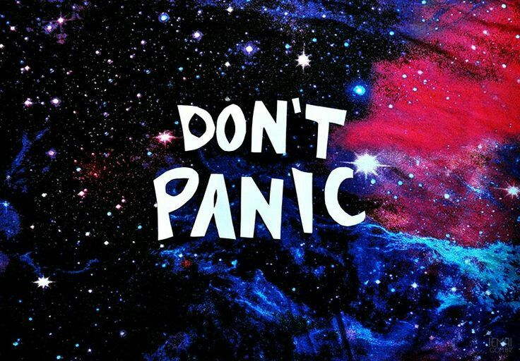

# Infinite Improbability Drive

> *"Governments of the Industrial World, you weary giants of flesh and steel — we are building the infrastructure you cannot control."*

**Project 42** — A cypherpunk nation in cyberspace. Powered by improbability.

**🌐 [infinitedrive.xyz](https://infinitedrive.xyz)** | **📚 [Official Documentation](https://docs.infinitedrive.xyz/en)** | **🔬 [Deep Thought Labs](https://deep-thought.computer)**

  

---

## Infinite Improbability Drive

Infinite Improbability Drive is **operational infrastructure** — the cryptographic backbone of our digital nation. Built with native EVM (Solidity) compatibility, full IBC protocol support, sovereign decentralized DNS, a truly decentralized P2P file system, and multi-chain bridges to Bitcoin, Ethereum, and Cosmos.

It is designed with **no single point of failure** and runs on infinite nodes, delivering true sovereignty, interoperability, and resilience for the cypherpunk nation in cyberspace.

### The Heart of the Drive: Improbability [42]

**Network Identity**

- **Chain Name**: `infinite`
- **Cosmos Chain ID**: `infinite_421018-1`
- **EVM Chain ID**: `421018`
- **Bech32 Prefix**: `infinite`

**Native Token**  
The native token is called **Improbability** with the symbol **`42`**.  
Yes — the famous 42 from *The Hitchhiker's Guide to the Galaxy*: the answer (and the question).

**Unit of Measurement**  
To keep things human and fun, we measure the token in **cups** (cups of Improbability). The smallest unit is called a **drop**.

- **1 cup** = 1 Improbability [42]
- **1 cup** = 1 taza de improbabilidad
- **1 cup** = 10¹⁸ drop

**In practice**  
When someone says “10 cups,” they simply mean 10 Improbability [42]. It's memorable, approachable, and carries the spirit of the project.

> *Each cup of Improbability is the fuel that powers the Infinite Improbability Drive. Without improbability, there is no Drive.*

---

### The Infinite Improbability Drive: A Philosophical Foundation

> *"The Infinite Improbability Drive is a wonderful new method of crossing vast interstellar distances in a mere nothingth of a second, without all that tedious mucking about in hyperspace."* — The Hitchhiker's Guide to the Galaxy

The **Infinite Improbability Drive** is the engine that powers this network — both literally and metaphorically. In Douglas Adams' universe, the drive works by generating improbability: when it reaches infinite improbability, it passes through every conceivable point in every conceivable universe simultaneously. It doesn't move through space in the conventional way; instead, it **warps probability itself**, turning the highly improbable into reality.

#### How It Works: Improbability as Fuel

The drive is created by connecting a Bambleweeny 57 Sub-Meson Brain to an atomic vector plotter suspended in a strong Brownian Motion producer — specifically, a **hot cup of tea**. In our network, each **cup of Improbability [42]** *is* that improbability — the raw fuel that bends probability and makes the impossible possible.

> *The drive runs on tea. Properly prepared.*

**Improbability is the counterforce to entropy.**

While entropy pushes the universe toward disorder, improbability introduces the chance for order to emerge from chaos. In our blockchain, this manifests through decentralized consensus: each validator adds to the improbability field, each transaction becomes a certain event through cryptographic proof, and each block collapses infinite possibilities into a single, verifiable truth.

> *"The most exciting phrase to hear in science, the one that heralds new discoveries, is not 'Eureka!' but 'That's funny...'"* — Isaac Asimov

---

## Running the Network

Node operation, releases, and validator guides live in the **[official documentation](https://docs.infinitedrive.xyz/en)**. Operators may also use **[Drive](https://github.com/deep-thought-labs/drive)**, our node management tool.

---

## Cypherpunk Roots & Future

From the beginning, this project stands on the shoulders of visionaries:

- John Perry Barlow (1996): *"Cyberspace does not lie within your borders."*
- Eric Hughes (1993): *"Privacy is the power to selectively reveal oneself."*
- Satoshi Nakamoto (2008): *"Cryptographic proof instead of trust."*

In the quantum age we are entering, every private key becomes a personal Infinite Improbability Drive — a gateway to an entire universe of possibilities. One person, with one device and one key, can hold a sovereign world of identities, directions, and futures. This is true digital sovereignty: infinite realities, accessible to anyone, controlled by no one.

> **"We are creating a world that all may enter without privilege or prejudice accorded by race, economic power, military force, or station of birth."**  
> — John Perry Barlow, *A Declaration of the Independence of Cyberspace*

---

## Links

- **Project**: [infinitedrive.xyz](https://infinitedrive.xyz) | [@InfiniteDrive42](https://x.com/InfiniteDrive42)
- **Research laboratory**: [DeepThought.Computer](https://deep-thought.computer) | [@DeepThought_Lab](https://x.com/DeepThought_Lab)
- **Community**: [Telegram](https://t.me/+nt8ysid_-8VlMDVh)
- **Official documentation**: [docs.infinitedrive.xyz](https://docs.infinitedrive.xyz/en)
- **License**: [Apache 2.0](./LICENSE)
- [NOTICE & Attributions](./NOTICE)

---

*Project 42. Building infrastructure for the cypherpunk nation. A [Deep Thought Labs](https://deep-thought.computer) project.*

Built on [Cosmos EVM](https://github.com/cosmos/evm).
